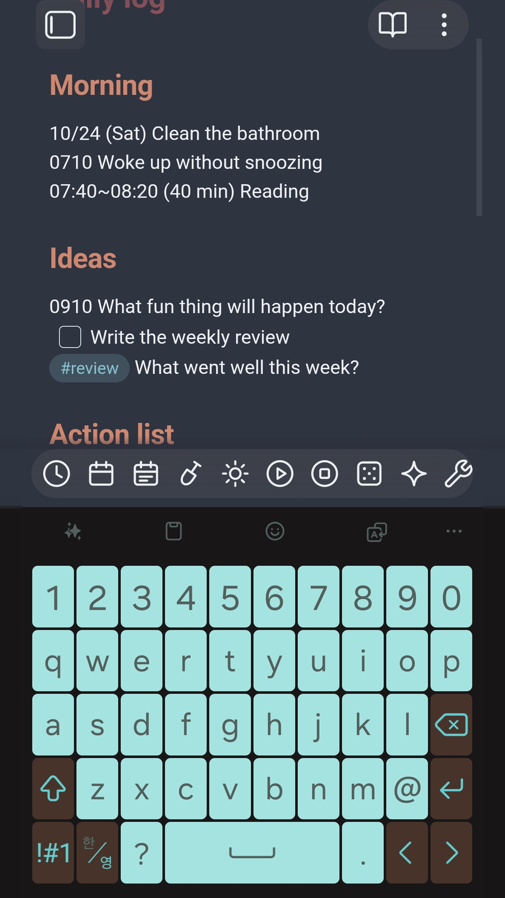
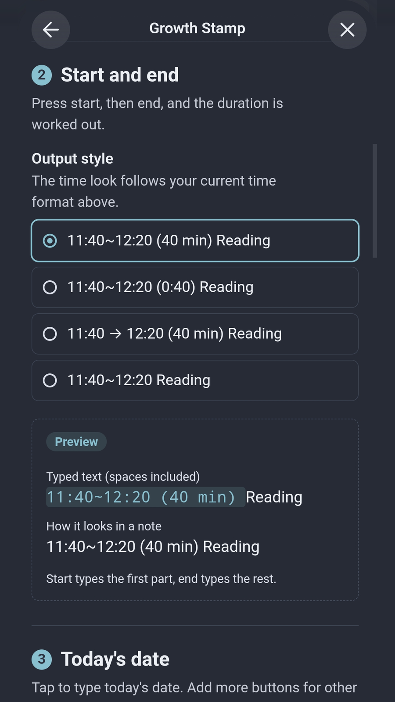
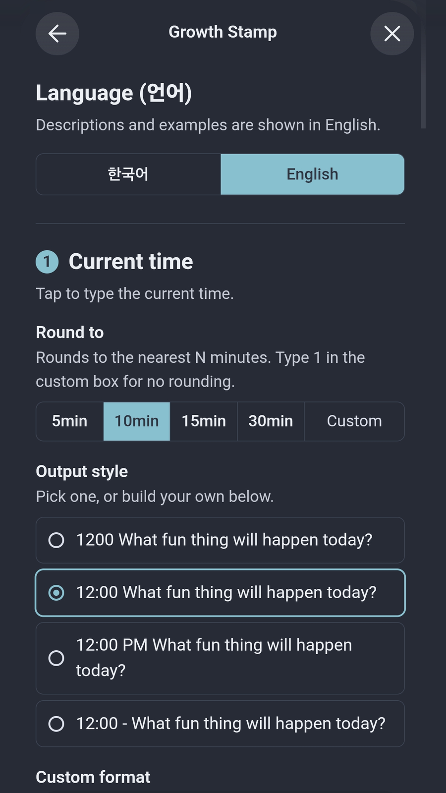

# Growth Stamp

**Stamp the "when" on everything you write.**
One tap on the mobile toolbar types the time, the date, how long something took, your favorite phrases, or a line from your affirmations.

Made for people who grow by writing things down: daily logs, journals, habit notes, study notes. Notes that carry a time are easier to look back on, and easier to hand to AI as context.

[한국어 안내는 아래에 있어요](#한국어)

## What each button does

| Button | What it types or does |
|---|---|
| **Insert current time** | `14:10 ` rounded to 5, 10, 15, 30 minutes, or any interval you choose |
| **Insert today's date** | `10/24 (Sat) ` Make as many date buttons as you like, each with its own style |
| **Insert start time / end time** | `11:40~` first, then `12:20 (40 min) ` with the duration worked out for you |
| **Insert phrase** | Any text you type often, like `- [ ] ` or `#review ` |
| **Copy heading section** | Copies the heading at your cursor and everything under it to the clipboard |
| **Open affirmation note** | Opens the note you read every day |
| **Show / insert random affirmation** | Picks one line from that note and shows it, or types it at the cursor |

## Getting started

1. Install and enable **Growth Stamp**.
2. Go to **Settings → Mobile → Toolbar options** and add the Growth Stamp commands you want.
3. Open the **Growth Stamp** settings and pick your styles. Each style shows a live preview of exactly what will be typed.

## Make it yours

- **Time style**: `1410 `, `14:10 `, `2:10 PM `, `14:10 - ` or build your own.
- **Date style**: `10/24 (Sat) `, `Oct 24 (Sat) `, `2026-10-24 `, `*Oct 24*` or build your own.
- **Trailing spaces** are kept, so you can start typing right after the stamp.

Tokens you can use in your own format:

| Token | Meaning | Example |
|---|---|---|
| `HH` / `H` | Hour, 24h | `08` / `8` |
| `hh` / `h` | Hour, 12h | `08` / `8` |
| `mm` | Minute | `30` |
| `A` | AM / PM | `AM` |
| `YYYY` / `YY` | Year | `2026` / `26` |
| `MMM` | Month name | `Oct` |
| `MM` / `M` | Month | `10` |
| `DD` / `D` | Day | `24` |
| `ddd` | Weekday | `Sat` |
| `[text]` | Kept as is | `[at]` |

## How a random affirmation is chosen

Every text line in your affirmation note can be picked. List marks (`- `, `1. `) and quote marks (`> `) are removed. Headings, dividers, blank lines, the properties block at the top, and `%%` comments are skipped. The same line never comes up twice in a row.

## Language

The settings and command names come in **English** and **Korean**. Growth Stamp follows your Obsidian language, and you can switch at the top of its settings.

## Privacy

Growth Stamp works fully offline and makes no network requests. Your settings stay in the plugin's data file in your vault. The clipboard is written only when you tap **Copy heading section**.

---

## 한국어

**쓰는 모든 기록에 "언제"를 도장처럼 찍어 주세요.**
모바일 툴바의 버튼 한 번으로 시간, 날짜, 걸린 시간, 자주 쓰는 문구, 확언 한 줄이 입력돼요.

일상 기록, 일기, 습관 노트, 공부 노트처럼 기록하면서 성장하는 사람들을 위해 만들었어요. 시점이 남아 있는 메모는 나중에 돌아보기 쉽고, AI에게 맥락으로 건네주기도 좋아요.

### 버튼별 기능

| 버튼 | 입력되는 내용 |
|---|---|
| **현재 시간 입력** | `1410 ` 5, 10, 15, 30분 또는 원하는 분 단위로 맞춰서 입력 |
| **오늘 날짜 입력** | `10/24(토) ` 형태가 다른 날짜 버튼을 여러 개 만들 수 있어요 |
| **시작 시각 / 끝 시각 입력** | 먼저 `11:40~`, 나중에 `12:20 (40분) ` 걸린 시간까지 계산 |
| **문구 입력** | 자주 쓰는 글자. 예: `- [ ] `, `#회고 ` |
| **헤딩 복사** | 커서가 있는 헤딩과 그 아래 내용을 통째로 클립보드에 복사 |
| **확언 메모 열기** | 매일 읽는 확언 메모를 바로 열기 |
| **랜덤 확언 보기 / 입력** | 확언 메모에서 한 줄을 뽑아 알림으로 보여 주거나 커서 위치에 입력 |

### 시작하기

1. **Growth Stamp**를 설치하고 켜세요.
2. **설정 → 모바일 → 툴바 옵션**에서 원하는 Growth Stamp 명령을 추가하세요.
3. **Growth Stamp** 설정에서 마음에 드는 형태를 고르세요. 형태를 고르는 곳마다 실제로 입력될 모습이 미리보기로 나와요.

### 랜덤 확언을 뽑는 기준

메모 안의 글줄을 하나씩 뽑아요. 목록 기호(`- `, `1. `)와 인용 기호(`> `)는 떼고 내용만 써요. 제목, 구분선, 빈 줄, 맨 위 속성 영역, `%%` 주석은 빼요. 같은 줄이 연속으로 나오지 않아요.

### 언어

설정 화면과 명령 이름을 **한국어**와 **영어**로 볼 수 있어요. 처음에는 옵시디언 언어를 따르고, 설정 맨 위에서 바꿀 수 있어요.

### 개인정보

인터넷 연결 없이 동작하고, 외부로 아무것도 보내지 않아요. 설정은 볼트 안의 플러그인 데이터 파일에만 저장돼요. 클립보드는 **헤딩 복사**를 눌렀을 때만 사용해요.

---

Made by Kmgn (Growing Swan). MIT License.
